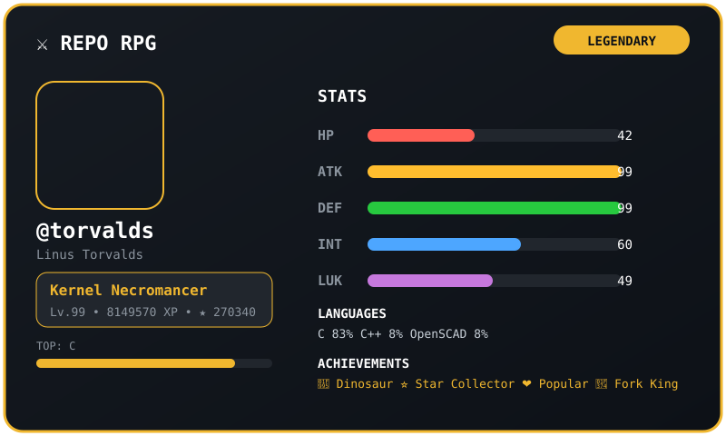

# ⚔️ RepoRPG — Turn Your GitHub into an RPG Character


Turn any GitHub profile into a fantasy RPG character card. No API key required.

<p align="center">
  
</p>

> **@torvalds — Kernel Necromancer Lv.99 [LEGENDARY]**
> HP: 42 · ATK: 99 · DEF: 99 · INT: 60 · LUK: 49
> 🦕 Dinosaur ⭐ Star Collector ❤️ Popular 🍴 Fork King

## ✨ Features

- 🧙 **30+ auto classes** based on your top language: Data Mage, Cloud Samurai, Kernel Necromancer, Memory Paladin…
- 📊 **RPG stats** from real GitHub data: `HP / ATK / DEF / INT / LUK`.
- 🏆 **Rarity system**: `COMMON → RARE → EPIC → LEGENDARY`, driven by XP.
- 🎖️ **Achievements**: Dinosaur, Star Collector, Polyglot, Popular, Prolific, Fork King…
- 🖼️ **Self-contained SVG** — the avatar is embedded, so it renders correctly inside a README ``.
- ⚡ **CLI + GitHub Action** (auto-updates your card daily).
- 🧩 **Zero dependencies** — pure Python standard library (3.9+).

## 🚀 Usage

No install needed:

```bash
python rpg.py --username torvalds --output card.svg
```

Then embed the card in your profile README (`username/username`):

```markdown

```

Useful flags:

```bash
python rpg.py -u torvalds -o card.svg            # basic
python rpg.py -u torvalds --theme light          # light theme
python rpg.py -u torvalds --no-avatar            # smaller file
python rpg.py -u torvalds --token ghp_xxx        # avoid the API rate limit
```

The token can also come from the `GITHUB_TOKEN` / `GH_TOKEN` environment variable.

### Offline mode (no network)

The repo ships with saved data, so you can try it with no internet access:

```bash
python rpg.py -u torvalds --from-json examples/torvalds.json -o card.svg
```

`--from-json` accepts `{"user": {...}, "repos": [...], "avatar_b64": "..."}`.

## 🤖 GitHub Action (auto-update daily)

Copy `.github/workflows/rpg.yml` into your **profile repository** (`username/username`).
It regenerates `profile-card.svg` every day and commits it, so your card levels up on its own.

```yaml
- run: python rpg.py -u ${{ github.repository_owner }} -o profile-card.svg
  env:
    GITHUB_TOKEN: ${{ secrets.GITHUB_TOKEN }}
```

> Tip: put the script, the workflow and the generated `profile-card.svg` in your profile repo
> (`YOURNAME/YOURNAME`), not in a separate one, so the raw link works.

## 🧙 Classes

| Language | Class | Language | Class |
|---|---|---|---|
| Python | Data Mage | Go | Cloud Samurai |
| JavaScript | Frontend Rogue | Rust | Memory Paladin |
| TypeScript | Type Wizard | C | Kernel Necromancer |
| Java | Enterprise Orc | C++ | Memory Barbarian |
| C# | Unity Knight | PHP | Legacy Sorcerer |
| Ruby | Startup Bard | Kotlin | Android Bard |
| Jupyter Notebook | AI Oracle | Shell | Terminal Hacker |
| Dart | Flutter Monk | R | Stat Druid |

…and more. Adding a class is a two-line PR — contributions welcome!

## 🧮 How the numbers work

```
XP    = followers×20 + public_repos×10 + stars×5 + forks×2
Level = min(99, 1 + ⌊√XP⌋ / 3)
HP    = min(99, 30 + public_repos)
ATK   = min(99, 20 + stars)
DEF   = min(99, 20 + followers)
INT   = min(99, 30 + languages×10)
LUK   = hash(username) mod 89 + 10
```

`LUK` is deterministic: the same username always rolls the same luck.

## 🧪 Tests

```bash
python -m unittest discover -s tests -v
```

16 offline tests (no network needed): level/rarity thresholds, XP and achievements,
class selection, SVG validity (parsed as XML), HTML-injection escaping, themes,
fixtures and terminal output.

## 📁 Project layout

```
rpg.py                     the whole program (standard library only)
tests/test_rpg.py          offline tests
examples/torvalds.json     saved profile data for --from-json
card.svg                   example card (auto-generated)
.github/workflows/         auto-update + tests
```

## 🇷🇺 По-русски

Коротко: превращает профиль GitHub в RPG-карточку. Запуск —
`python rpg.py -u ВАШ_НИК` (зависимостей нет), офлайн-проверка —
`python rpg.py -u torvalds --from-json examples/torvalds.json`. Тесты:
`python -m unittest discover -s tests -v`.

## 📜 License

MIT — use it freely. If you like it, drop a ⭐ — it really helps!
